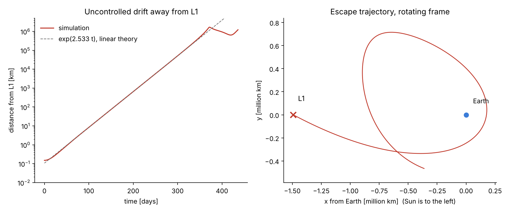
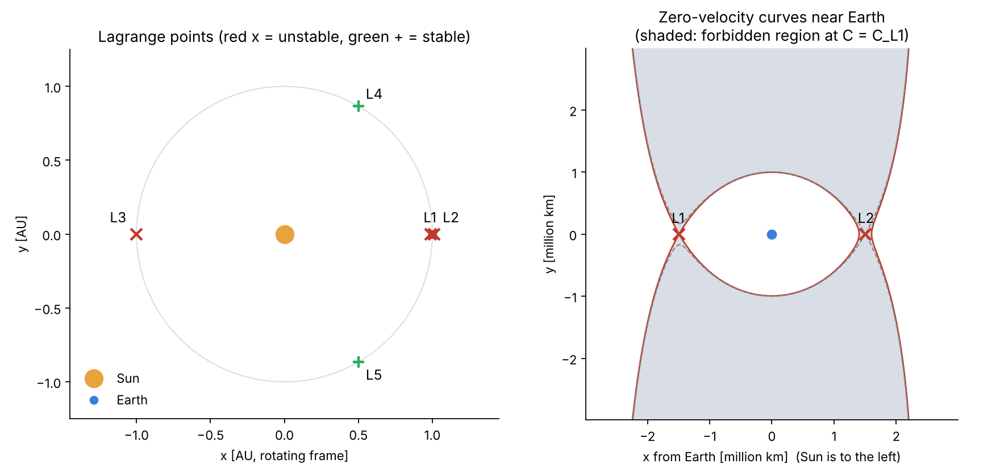
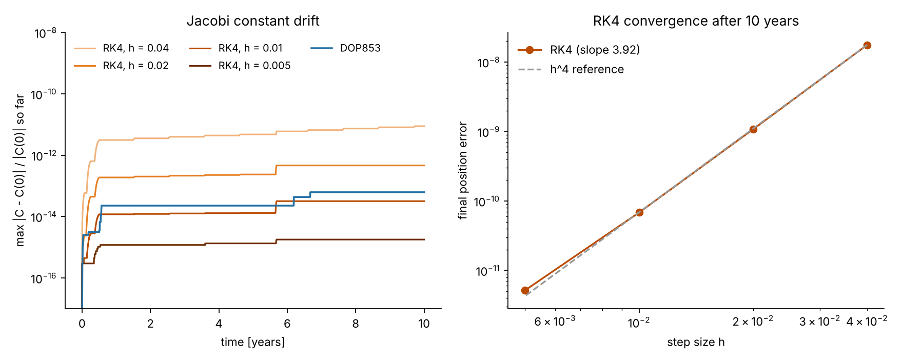
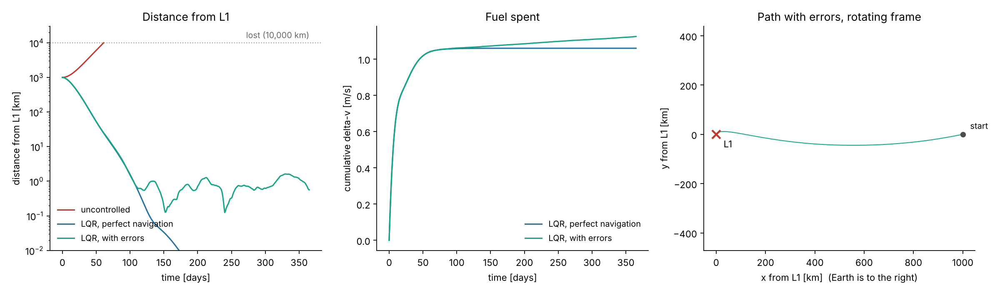
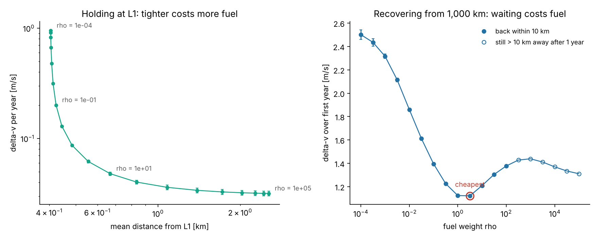

# L1 Station-Keeping: LQR vs Reinforcement Learning

Can a reinforcement learning agent keep a spacecraft at the unstable Sun–Earth L1 point using less fuel (Δv) than a classical LQR controller?

The Sun–Earth L1 point sits about 1.49 million km sunward of Earth. It is an equilibrium of the circular restricted three-body problem (CR3BP), but an unstable one: a spacecraft left there with a 150 m error drifts away by a factor of *e* every 23 days and is more than a million kilometres off within a year. Missions such as SOHO (at L1) and JWST (at L2) fire their thrusters regularly to stay in place. This project builds the dynamics from scratch, verifies them, and compares an LQR controller with DQN and PPO agents on the station-keeping task.



*Left: distance from L1 grows exactly at the rate predicted by the unstable eigenvalue (λ = 2.533). Right: the escape trajectory in the rotating frame.*

## Status

| Phase | Content | Status |
| --- | --- | --- |
| 1 | CR3BP simulator, RK4 + DOP853, Jacobi-constant validation | Done |
| 2 | Lagrange points, linear stability, uncontrolled escape from L1 | Done |
| 3 | LQR baseline controller, fuel/accuracy trade-off | Done |
| 4 | Gymnasium environment, DQN agent | Planned |
| 5 | PPO agent, comparison experiments (Δv, tracking error, robustness) | Planned |
| 6 | Paper | Planned |

## Results so far

**Lagrange points (Sun–Earth, μ = 3.0034 × 10⁻⁶)**

| Point | Distance from Earth | Unstable growth rate | e-folding time |
| --- | --- | --- | --- |
| L1 | 1,491,539 km | 2.533 | 23.0 days |
| L2 | 1,501,519 km | 2.484 | 23.4 days |
| L3 | 299,195,479 km | 0.0028 | ~57 years |
| L4, L5 | 1 AU (60° ahead / behind) | 0 (stable, Routh: μ < 0.0385) | — |



**Integrator validation.** Over 10 years, DOP853 keeps the relative Jacobi-constant error below 10⁻¹³; fixed-step RK4 converges with measured order 3.92 (theory: 4).



**LQR station-keeping (phase 3).** A discrete-time LQR updates the thrust once per day from a noisy navigation estimate. Starting 1,000 km from L1, the uncontrolled spacecraft is lost (> 10,000 km) after 61 days; LQR brings it back and holds it for a full year.



Sweeping the fuel weight ρ over nine orders of magnitude (5 seeds each) gives the baseline the RL agents must beat:

- **Holding** (start at L1): 0.03–0.95 m/s per year of Δv, for a mean distance of 2.5–0.4 km. Below ~0.4 km, navigation errors set the floor and extra fuel buys almost nothing. Without control, unmodelled forces alone push the spacecraft out within 230–260 days.
- **Acquisition** (start 1,000 km away): the cheapest gain (ρ = 3) needs 1.12 m/s. Lazier gains cost *more*, because the unstable mode keeps growing while the controller waits.



Error model (1σ, illustrative assumptions): navigation errors of 1 km and 1 mm/s, thrust errors of 2 % in magnitude and 1° in pointing, and a random unmodelled acceleration of 10⁻⁹ m/s² per axis per day (solar radiation pressure changes, the Moon, planets). Raw results: `experiments/lqr_pareto.csv`.

**Current simplifications.** The spacecraft holds the L1 point itself; real missions fly halo or Lissajous orbits around it (to keep the Sun out of the antenna beam). Motion is planar, and thrust is a low, continuous push updated daily rather than impulsive burns weeks apart. These are deliberate, so LQR and RL are compared on identical, controlled conditions.

## The model

Nondimensional units: the Sun–Earth distance is 1, the total mass is 1, and one year is 2π time units (1 time unit ≈ 58.1 days). In the frame rotating with the Earth:

```
x'' - 2y' = ∂Ω/∂x + uₓ
y'' + 2x' = ∂Ω/∂y + u_y
z''       = ∂Ω/∂z + u_z

Ω = (x² + y²)/2 + (1 - μ)/r₁ + μ/r₂
```

`u` is the control acceleration supplied by the thrusters. With `u = 0` the Jacobi constant `C = 2Ω − v²` is conserved, which is the main accuracy check.

Velocity Verlet is not used because the Coriolis term depends on velocity, which breaks the scheme's symplectic property. RK4 (fixed step) drives the RL environment; DOP853 (adaptive, scipy) is the reference.

## Quick start

```bash
git clone https://github.com/<your-username>/l1-station-keeping.git
cd l1-station-keeping
pip install -e ".[dev]"

pytest                                  # correctness tests
python scripts/01_lagrange_points.py    # table + figures/lagrange_points.png
python scripts/02_jacobi_validation.py  # figures/jacobi_validation.png
python scripts/03_l1_escape.py          # figures/l1_escape.png
python scripts/04_lqr_station_keeping.py # figures/lqr_station_keeping.png
python scripts/05_lqr_pareto.py         # figures/lqr_pareto.png (~30 s)
```

```python
import numpy as np
from cr3bp import MU_SUN_EARTH, lagrange_points, stability, rhs, dop853

mu = MU_SUN_EARTH
l1 = lagrange_points(mu)["L1"]
print(stability(l1, mu)["efold_days"])       # ~23.0

s0 = np.r_[l1 + [1e-9, 0, 0], 0, 0, 0]       # 150 m off L1, at rest
t, states = dop853(lambda t, s: rhs(t, s, mu), s0, t_end=6.0)
```

## Repository layout

```
src/cr3bp/
  constants.py     mass ratio and unit conversions (km, days, m/s)
  dynamics.py      equations of motion, effective potential, Jacobi constant
  integrators.py   RK4 and DOP853
  lagrange.py      L1–L5, Hessian, linearisation, eigenvalue stability
  control/
    station_keeping.py   simulator: daily thrust, navigation/thrust errors, delta-v log
    lqr.py               ZOH discretisation, discrete Riccati, LQR controller
experiments/       raw CSV results
scripts/           one script per figure
tests/             pytest suite
figures/           generated plots
```

## References

- W. S. Koon, M. W. Lo, J. E. Marsden, S. D. Ross, *Dynamical Systems, the Three-Body Problem and Space Mission Design*.
- V. Szebehely, *Theory of Orbits: The Restricted Problem of Three Bodies*. Academic Press, 1967.
- S. H. Strogatz, *Nonlinear Dynamics and Chaos*.
- R. S. Sutton, A. G. Barto, *Reinforcement Learning: An Introduction*, 2nd ed. MIT Press, 2018.

## License

MIT © 2026 Emir Eymen Sargın
