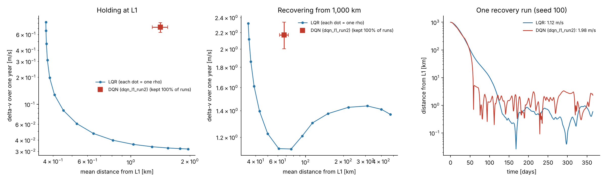
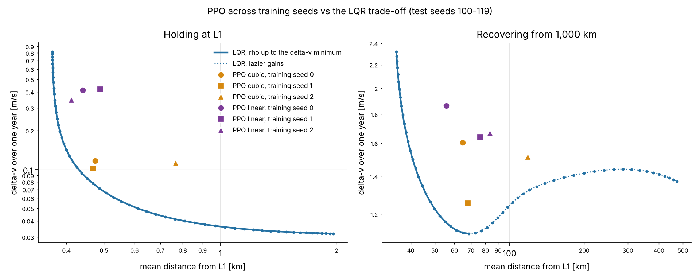
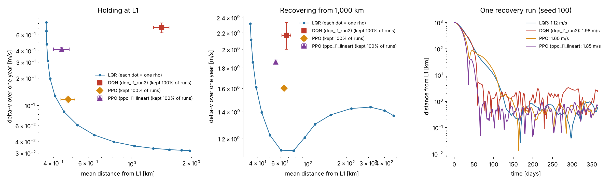
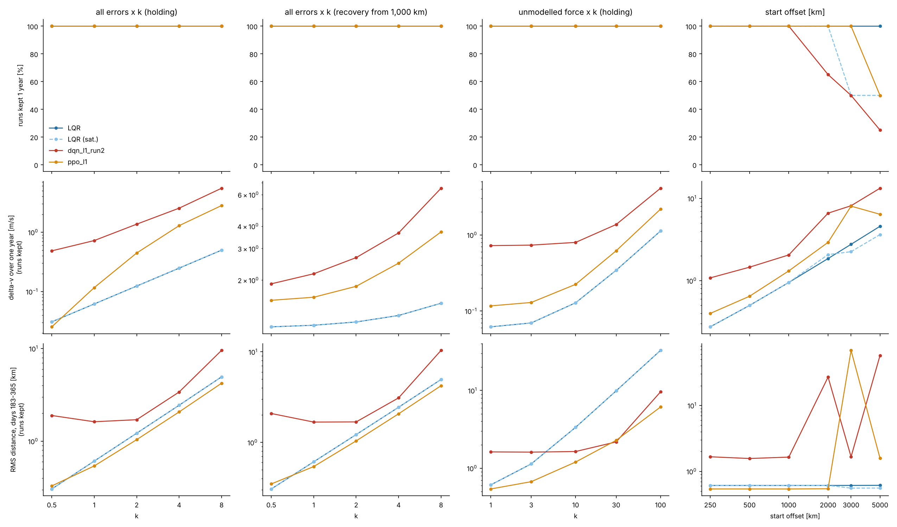

# L1 Station-Keeping: LQR vs Reinforcement Learning

Can a reinforcement learning agent keep a spacecraft at the unstable Sun–Earth L1 point using less fuel (Δv) than a classical LQR controller?

The Sun–Earth L1 point sits about 1.49 million km sunward of Earth. It is an equilibrium of the circular restricted three-body problem (CR3BP), but an unstable one: a spacecraft left there with a 150 m error drifts away by a factor of *e* every 23 days and is more than a million kilometres off within a year. Missions such as SOHO (at L1) and JWST (at L2) fire their thrusters regularly to stay in place. This project builds the dynamics from scratch, verifies them, and compares an LQR controller with DQN and PPO agents on the station-keeping task.

**Short answer: no.** Across three training seeds, PPO with continuous thrust needs 1.3–2.7× LQR's fuel at the same accuracy while holding (DQN: 2–12×) and never beats LQR on fuel. One of the three PPO seeds also handled the thrust limit better than a saturated LQR, but the other two did not.

📄 **Paper draft:** [`paper/main.pdf`](paper/main.pdf) · **Reproduce everything:** `make reproduce` (see [Reproducing the results](#reproducing-the-results))


*Left: distance from L1 grows exactly at the rate predicted by the unstable eigenvalue (λ = 2.533). Right: the escape trajectory in the rotating frame.*

## Status

| Phase | Content | Status |
| --- | --- | --- |
| 1 | CR3BP simulator, RK4 + DOP853, Jacobi-constant validation | Done |
| 2 | Lagrange points, linear stability, uncontrolled escape from L1 | Done |
| 3 | LQR baseline controller, fuel/accuracy trade-off | Done |
| 4 | Gymnasium environment, DQN agent, comparison with LQR | Done |
| 5 | PPO agent, comparison experiments (Δv, tracking error, robustness), 3 training seeds | Done |
| 6 | Paper draft (numbers generated from the CSVs), one-command reproduction, CI | Done |

## Results

**Lagrange points (Sun–Earth, μ = 3.0034 × 10⁻⁶)**

| Point | Distance from Earth | Unstable growth rate | e-folding time |
| --- | --- | --- | --- |
| L1 | 1,491,539 km | 2.533 | 23.0 days |
| L2 | 1,501,519 km | 2.484 | 23.4 days |
| L3 | 299,195,479 km | 0.0028 | ~57 years |
| L4, L5 | 1 AU (60° ahead / behind) | 0 (stable, Routh: μ < 0.0385) | — |


**Integrator validation.** Over 10 years, DOP853 keeps the relative Jacobi-constant error below 10⁻¹³; fixed-step RK4 converges with measured order 3.92 (theory: 4).


**LQR station-keeping (phase 3).** A discrete-time LQR updates the thrust once per day from a noisy navigation estimate. Starting 1,000 km from L1, the uncontrolled spacecraft is lost (> 10,000 km) after 61 days; LQR brings it back and holds it for a full year.


Sweeping the fuel weight ρ over nine orders of magnitude (5 seeds each) gives the baseline the RL agents must beat:

- **Holding** (start at L1): 0.03–0.95 m/s per year of Δv, for a mean distance of 2.5–0.4 km. Below ~0.4 km, navigation errors set the floor and extra fuel buys almost nothing. Without control, unmodelled forces alone push the spacecraft out within 230–260 days.
- **Acquisition** (start 1,000 km away): the cheapest gain (ρ = 3) needs 1.12 m/s. Lazier gains cost *more*, because the unstable mode keeps growing while the controller waits.


Error model (1σ, illustrative assumptions): navigation errors of 1 km and 1 mm/s, thrust errors of 2 % in magnitude and 1° in pointing, and a random unmodelled acceleration of 10⁻⁹ m/s² per axis per day (solar radiation pressure changes, the Moon, planets). Raw results: `experiments/lqr_pareto.csv`.

**DQN vs LQR (phase 4).** A DQN agent picks one of 25 actions each day: coast, or thrust in one of 8 directions at 10⁻⁸, 10⁻⁷ or 10⁻⁶ m/s². Two training runs of 1M steps each; the best checkpoint of each run is tested on 20 seeds never used in training or model selection.

| Controller | Holding: Δv / year | Holding: mean distance | Recovery from 1,000 km: Δv | Recovery: mean distance | Runs kept 1 year |
| --- | --- | --- | --- | --- | --- |
| No control | 0 | lost after ~250 days | 0 | lost after 61 days | 0 % |
| LQR (ρ = 3) | 0.062 m/s | 0.5 km | 1.12 m/s | 76 km | 100 % |
| DQN run 1 | 0.42 m/s | 10.9 km | 2.11 m/s | 118 km | 100 % |
| DQN run 2 (lower learning rate, stronger distance penalty) | 0.72 m/s | 1.4 km | 2.17 m/s | 68 km | 100 % |

Both agents learned to keep the spacecraft in every test episode, but LQR uses 2–12× less fuel. The thrust logs show why: while holding, LQR's thrust is about 2 × 10⁻⁹ m/s², five times below the smallest discrete DQN action. Run 1 fires that smallest level on 351 of 365 days; run 2 coasts on 214 days and over-corrects with 10⁻⁷ m/s² on 97. The gap comes from the coarse action set rather than from learning, which is what phase 5 tests with continuous-thrust PPO. Run 1 also collapsed after 700k steps (a known DQN instability); run 2's lower learning rate and slower target updates kept training stable.



**PPO vs LQR (phase 5).** PPO outputs a continuous 2-D thrust vector, capped at the same 10⁻⁶ m/s² as DQN's largest action. The action *a* (|*a*| ≤ 1) is mapped to thrust *u* = *u*ₘₐₓ |*a*|³ *a*/|*a*|: the cubic map makes the ~2 × 10⁻⁹ m/s² holding thrust a moderate action (|*a*| ≈ 0.13) instead of 0.002 of full scale. A second configuration with the plain linear map (|*a*|¹) isolates the effect of this choice. Every run: 3M steps, 8 parallel environments, same reward and model selection as DQN run 2 (~11 min each). Each configuration was trained with three training seeds (0, 1, 2) and otherwise identical hyperparameters, to check that the results are not one lucky run. Test seeds 100–119; the "3 seeds" rows are mean ± standard deviation (n = 3, ddof = 1) across training seeds:

| Controller | Holding: Δv / year | Holding: mean / RMS distance | Recovery: Δv | Recovery: mean distance | Runs kept 1 year |
| --- | --- | --- | --- | --- | --- |
| LQR (ρ = 3) | 0.062 m/s | 0.5 / 0.6 km | 1.12 m/s | 76 km | 100 % |
| DQN run 2 | 0.72 m/s | 1.4 / 1.6 km | 2.17 m/s | 68 km | 100 % |
| PPO, linear thrust map (training seed 0) | 0.41 m/s | 0.4 / 0.5 km | 1.86 m/s | 56 km | 100 % |
| PPO, cubic thrust map (training seed 0) | 0.12 m/s | 0.5 / 0.5 km | 1.60 m/s | 65 km | 100 % |
| PPO, linear thrust map (3 seeds) | 0.39 ± 0.04 m/s | 0.45 ± 0.04 / 0.51 ± 0.04 km | 1.72 ± 0.12 m/s | 72 ± 14 km | 100 % |
| **PPO, cubic thrust map (3 seeds)** | **0.110 ± 0.007 m/s** | **0.57 ± 0.17 / 0.64 ± 0.18 km** | **1.46 ± 0.18 m/s** | **84 ± 30 km** | 100 % |

PPO does not track at exactly the accuracy of LQR ρ = 3, so the fair comparison is against LQR tuned to the *same* accuracy. `scripts/10_seed_study.py` sweeps LQR over 57 values of ρ (10⁻³–10⁴) on the test seeds, keeps the branch from the tightest gain up to the Δv minimum (beyond it, lazier gains cost more fuel again), and interpolates log-log at each model's mean distance:

| PPO model | Holding: × LQR fuel at same accuracy | Recovery: × LQR fuel at same accuracy | Best checkpoint |
| --- | --- | --- | --- |
| cubic, seed 0 | 1.54 | 1.44 | 250k steps |
| cubic, seed 1 | 1.31 | 1.13 | 250k steps |
| cubic, seed 2 | 2.74 | dominated (≥ 1.37) | 200k steps |
| linear, seed 0 | 4.48 | 1.61 | 2.95M steps |
| linear, seed 1 | 5.92 | dominated (≥ 1.48) | 1.2M steps |
| linear, seed 2 | 2.90 | dominated (≥ 1.50) | 2.9M steps |
| **cubic, mean ± std** | **1.87 ± 0.77** | — | |
| linear, mean ± std | 4.43 ± 1.51 | — | |

"Dominated" means the model tracks *less* tightly than the cheapest LQR (ρ ≈ 1.8: 1.11 m/s at 69 km), which is therefore both cheaper and more accurate; the bracket is the ratio to that cheapest LQR, a lower bound. The single-seed figure quoted before ("1.6× / 1.4×", training seed 0, from a coarser interpolation) does not carry over as one number: across three training seeds the cubic agent needs 1.3–2.7× LQR's fuel while holding and 1.1–1.4× (or is dominated) for recovery. What does hold in all three seeds is the conclusion: **every PPO model sits above the LQR curve, so LQR is still Pareto-optimal.**





The thrust logs (holding, seed 100) show what changed since phase 4. PPO's median daily thrust is 1.73 × 10⁻⁹ m/s², almost exactly LQR's 1.79 × 10⁻⁹, so the agent did learn the right thrust scale. The extra fuel comes from the tail: PPO thrusts above 10⁻⁸ m/s² on 27 days, LQR on none. With the linear map the median is 1.0 × 10⁻⁸ m/s² (185 days above 10⁻⁸): the network cannot output 0.002 of full scale precisely enough. Across the three training seeds the linear map needs 3.1–4.1× the cubic map's holding fuel (0.39 ± 0.04 vs 0.110 ± 0.007 m/s, while tracking slightly tighter: 0.45 vs 0.57 km) and 1.1–1.3× its recovery fuel, with no overlap between the two configurations in either scenario. **In all 3 training seeds, most of the DQN–LQR gap was the action representation, not learning.** With the cubic map the best checkpoint came early in all 3 training seeds (200k–250k of 3M steps); longer training traded fuel for slightly tighter tracking and never raised the selection score again (`figures/ppo_l1_learning_curve.png`). The linear map is different: its best checkpoints came at 1.2M–2.95M steps.

**Robustness (phase 5).** All controllers were trained or tuned with the nominal error model and start offsets ≤ 1,000 km. `scripts/09_robustness.py` pushes them past that on the test seeds. Because the agents can thrust at most 10⁻⁶ m/s² and plain LQR has no limit, LQR is also flown saturated at 10⁻⁶ m/s² ("sat.").

The PPO column covers the cubic agent's three training seeds (`scripts/09_robustness.py --model ppo_l1 ppo_l1_s1 ppo_l1_s2 --out robustness_seeds`): a range is min–max over the seeds, and kept rates are listed as seed 0 / 1 / 2.

| Sweep (Δv / RMS distance in days 183–365) | LQR | PPO cubic, 3 training seeds | DQN |
| --- | --- | --- | --- |
| All errors ×0 (holding) | 0.00 m/s / 0.0 km | 0.00–0.01 m/s / 0.7–1.5 km | 0.36 m/s / 2.7 km |
| All errors ×1 (holding) | 0.06 m/s / 0.6 km | 0.10–0.12 m/s / 0.5–0.8 km | 0.72 m/s / 1.6 km |
| All errors ×8 (holding) | 0.50 m/s / 4.9 km | 2.02–2.81 m/s / 4.2–4.3 km | 5.49 m/s / 9.6 km |
| Unmodelled force ×100 (holding) | 1.13 m/s / 33 km | 1.87–2.18 m/s / 6.1–9.6 km | 4.10 m/s / 9.6 km |
| Start 2,000 km away: kept | 100 % (sat.: 100 %) | 100 % / 100 % / 100 % | 65 % |
| Start 3,000 km away: kept | 100 % (sat.: 50 %) | 100 % / 50 % / 50 % | 50 % |
| Start 5,000 km away: kept | 100 % (sat.: 50 %) | 50 % / 50 % / 50 % | 25 % |

- **Noise.** No controller lost a single run at up to 8× the nominal errors (all 3 PPO training seeds). PPO's fuel overhead grows with noise, from 1.6–1.9× LQR at nominal to 4.0–5.6× at ×8: it reacts to navigation noise instead of averaging it out, while LQR's gain is linear in the error by construction.
- **Unmodelled forces.** With a 100× stronger unmodelled force, LQR ρ = 3 drifts to 33 km RMS because its gain was tuned for nominal conditions; PPO holds 6–10 km with 1.7–1.9× the fuel. The two are no longer at the same point of the trade-off, so neither "wins" here.
- **Large offsets and the thrust limit.** Apart from DQN at 5,000 km, every lost run started on the Sun–Earth line (0° or 180°), the direction of the unstable mode. A rough estimate of the mode's pull, λ²r, is 0.76 × 10⁻⁶ m/s² at 3,000 km and 1.27 × 10⁻⁶ m/s² at 5,000 km: at 5,000 km it exceeds the 10⁻⁶ m/s² limit, which is why all bounded controllers lose exactly those runs. At 3,000 km recovery is possible but only just: saturated LQR, whose gain ignores the limit, loses all 10 runs on the Sun–Earth line. PPO training seed 0 keeps them, at a cost of ~13 m/s and still 56–215 km off (RMS, second half of the year), **but training seeds 1 and 2 lose exactly the same 10 runs as saturated LQR.** So the earlier claim that PPO handles the thrust limit better than saturated LQR does not hold across training seeds; it was a property of one run. Unlimited LQR keeps everything but needs up to 4.9 × 10⁻⁶ m/s².



Raw results: `experiments/comparison_phase5.csv`, `experiments/robustness.csv` (training seed 0 only), `experiments/seed_study.csv` (+ `seed_study_lqr.csv`, the 57-point LQR sweep), `experiments/robustness_seeds.csv`.

**Current simplifications.** The spacecraft holds the L1 point itself; real missions fly halo or Lissajous orbits around it (to keep the Sun out of the antenna beam). Motion is planar, and thrust is a low, continuous push updated daily rather than impulsive burns weeks apart. These are deliberate, so LQR and RL are compared on identical, controlled conditions.

## The model

Nondimensional units: the Sun–Earth distance is 1, the total mass is 1, and one year is 2π time units (1 time unit ≈ 58.1 days). In the frame rotating with the Earth:

```
x'' - 2y' = ∂Ω/∂x + uₓ
y'' + 2x' = ∂Ω/∂y + u_y
z''       = ∂Ω/∂z + u_z

Ω = (x² + y²)/2 + (1 - μ)/r₁ + μ/r₂
```

`u` is the control acceleration supplied by the thrusters. With `u = 0` the Jacobi constant `C = 2Ω − v²` is conserved, which is the main accuracy check.

Velocity Verlet is not used because the Coriolis term depends on velocity, which breaks the scheme's symplectic property. RK4 (fixed step) drives the RL environment; DOP853 (adaptive, scipy) is the reference.

## Reproducing the results

```bash
git clone https://github.com/eeymens/l1-station-keeping.git
cd l1-station-keeping
make install        # pip install -e ".[dev,rl]"  (CPU-only PyTorch is enough)
make test           # pytest, 36 tests
make reproduce      # every figure, CSV and paper number from the trained models (~10 min)
make paper          # paper/main.pdf (needs LaTeX)
```

`make reproduce` evaluates the trained agents in `models/`; it does not retrain them. Re-running it on the committed models reproduces the CSVs in `experiments/` exactly. `make train` retrains all eight agents from scratch (~2 h on one core); PyTorch's nondeterminism across machines means retrained agents will differ slightly from the committed ones. `make -n <target>` prints the individual commands, one script per figure:

| Script | Output |
| --- | --- |
| `01_lagrange_points.py` | Lagrange-point table, `figures/lagrange_points.png` |
| `02_jacobi_validation.py` | `figures/jacobi_validation.png` |
| `03_l1_escape.py` | `figures/l1_escape.png` |
| `04_lqr_station_keeping.py` | `figures/lqr_station_keeping.png` |
| `05_lqr_pareto.py` | `experiments/lqr_pareto.csv`, `figures/lqr_pareto.png` |
| `06_train_dqn.py` | `models/dqn_*`, training log and learning curve |
| `07_compare_controllers.py` | `experiments/comparison_*.csv`, `figures/lqr_vs_*.png` |
| `08_train_ppo.py` | `models/ppo_*`, training log and learning curve |
| `09_robustness.py` | `experiments/robustness*.csv`, `figures/robustness*.png` |
| `10_seed_study.py` | `experiments/seed_study*.csv`, `figures/seed_study.png` |
| `11_paper_assets.py` | `paper/generated/` — every number and table in the paper |

Package versions verified to reproduce the committed results: [`requirements-lock.txt`](requirements-lock.txt).

```python
import numpy as np
from cr3bp import MU_SUN_EARTH, lagrange_points, stability, rhs, dop853

mu = MU_SUN_EARTH
l1 = lagrange_points(mu)["L1"]
print(stability(l1, mu)["efold_days"])       # ~23.0

s0 = np.r_[l1 + [1e-9, 0, 0], 0, 0, 0]       # 150 m off L1, at rest
t, states = dop853(lambda t, s: rhs(t, s, mu), s0, t_end=6.0)
```

## Repository layout

```
src/cr3bp/
  constants.py     mass ratio and unit conversions (km, days, m/s)
  dynamics.py      equations of motion, effective potential, Jacobi constant
  integrators.py   RK4 and DOP853
  lagrange.py      L1–L5, Hessian, linearisation, eigenvalue stability
  control/
    station_keeping.py   simulator: daily thrust, navigation/thrust errors, delta-v log
    lqr.py               ZOH discretisation, discrete Riccati, LQR controller
  envs/l1_env.py         gymnasium environment (discrete or continuous thrust)
  evaluation.py          common test protocol: same scenarios and seeds for every controller
  training.py            shared RL pieces: evaluation callback, model config, load_policy
models/            trained agents (best checkpoint of each run) + .json with env settings
experiments/       raw CSV results
scripts/           one script per figure
tests/             pytest suite
figures/           generated plots
paper/             manuscript (main.tex, references.bib, generated/ numbers and tables)
Makefile           install, test, reproduce, paper, train
```

## References

- W. S. Koon, M. W. Lo, J. E. Marsden, S. D. Ross, *Dynamical Systems, the Three-Body Problem and Space Mission Design*.
- V. Szebehely, *Theory of Orbits: The Restricted Problem of Three Bodies*. Academic Press, 1967.
- S. H. Strogatz, *Nonlinear Dynamics and Chaos*.
- R. S. Sutton, A. G. Barto, *Reinforcement Learning: An Introduction*, 2nd ed. MIT Press, 2018.
- Full reference list: [`paper/references.bib`](paper/references.bib).

## Citing

If you use this code or its results, please cite it via [`CITATION.cff`](CITATION.cff) (GitHub's "Cite this repository" button).

## License

MIT © 2026 Emir Eymen Sargın
